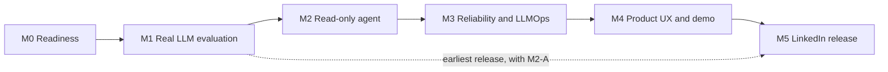

# AI engineering roadmap

| | |
|---|---|
| **Status** | Active. M1 awaiting approval. M2 merged. M3-A merged (PR #57). M3-B0.1 scorer hardening in review. M3-B0.2 dataset remediation next. M3-B needs separate authorization per stage |
| **Owner** | Aziz Ben Ammar |
| **Baseline** | `main` at `2c83cb3`, audited 2026-11-01 |
| **Next milestone** | M3-B0.2, dataset remediation and second-person label review. Then M3-B and M1, each stage with its own authorization |
| **Final milestone** | [LINKEDIN DEMO & PORTFOLIO RELEASE](#m5--linkedin-demo--portfolio-release) |
| **Publish by** | 2026-12-13 (target), with a scope decision on 2026-11-29 |
| **Related** | [Demo plan](LINKEDIN_DEMO_PLAN.md) · [Post draft](LINKEDIN_POST_DRAFT.md) · [Current architecture](ARCHITECTURE_CURRENT.md) · [Target architecture](ARCHITECTURE_TARGET.md) |

## Summary

FootballAI has a real platform and a safe, evaluated copilot foundation, but no
language model has ever been called. M2-B and M2-C add a bounded read-only agent and a
local endpoint with a visible tool trace, driven by a scripted adapter. M3-A adds a gated
real-model path, a cost guard, and a benchmark, all tested against a local server. The fastest
honest path to a strong portfolio piece is:

1. measure the real model cheaply;
2. fix the known demo blockers;
3. build one small read-only agent;
4. evaluate it;
5. publish only what the evidence supports.

## Recommended positioning

**Today:** *FootballAI: a cloud-native football video analysis platform with an
evidence-grounded AI copilot.*

**After M2 and M3 pass:** *FootballAI: a read-only AI agent that answers only from
verified football-video evidence, and says when it can't.*

The proposed name "Agentic Football Intelligence Platform" should not be used yet:

- "Agentic" is earned only when a real tool-calling loop is validated.
- "Football intelligence" overclaims. There are no passes, shots, possession,
  formations, or verified player identities.

The strongest recruiter story is not football insight. It is the engineering:
**a model that cannot invent a fact by construction, measured against a
deterministic baseline, with its failures published.** That is rarer than another
chatbot, and it is true.

## Validation status

| Capability | State | Evidence |
|---|---|---|
| Real CV inference | **VALIDATED** | Run `87da5c1b` is `verified_real`, on private footage that must not be published |
| Grounded Copilot | **VALIDATED** | Citations, abstention, and browser checks, with the offline deterministic selector |
| Offline scripted agent | **VALIDATED** | [Browser validation](../v2/COPILOT_AGENT.md#browser-validation), mutation tests, and baselines |
| Real-model path | **BUILT, LOCALLY TESTED, OFF BY DEFAULT** | [Guide](../v2/COPILOT_AGENT_REAL_MODEL.md). Tested with the pinned SDK against 127.0.0.1 only |
| Agent scorer and decision rule | **HARDENED, OFFLINE ONLY** | [ADR-008](../v2/ADR-008-agent-evaluation-reliability.md). Twelve controls, scorer v2. Rule v2 proposed, and cannot pass on the current held-out split |
| Actual LLM tool calling | **NOT YET VALIDATED** | Never run live. Needs separate approval |
| LinkedIn release | **PLANNED** | Nothing recorded or published |

## Actual versus planned

| Capability | State today |
|---|---|
| Video upload, async analysis, immutable versioned runs | IMPLEMENTED, VERIFIED |
| Real YOLOv8m + ByteTrack | VERIFIED locally. Full-match runs only on a laptop |
| Azure staging | DEPLOYED at last evidence (2026-09-05). UNVERIFIED now |
| Grounded copilot with citations and abstention | IMPLEMENTED, VERIFIED, local and test only |
| Deterministic baseline | VERIFIED, reproduced 2026-11-01 |
| Real LLM in the copilot | IMPLEMENTED, **never run live** |
| Tool-using agent | IMPLEMENTED offline. M2 merged. **No model has driven it.** A local-only endpoint reaches it, scripted by default. M3-A adds a gated real path, in review |
| Agent evaluation and traces | Deterministic only. 114-case benchmark and runner merged in M3-A. Scorer v2, rule v2, and twelve controls in M3-B0.1. Real-model evaluation is **PLANNED** |
| Question box in the dashboard | IMPLEMENTED in M2-A, merged. Browser-checked locally on 2026-11-01 |
| Observability on `main` | JSON logs and health endpoints only. P6 is not merged |
| RAG, MCP, multi-agent | Not planned. No need has been shown |

## Repository truth on 2026-11-01

| Item | Finding |
|---|---|
| `main` | `2c83cb33749549b6c4d9aeed4355ec4795806631` |
| Merged | PR #44, #47, #48, #50 confirmed |
| CI on `main` | CI, Security, and Build images all succeeded on `2c83cb3` |
| Build images run 41333208361 | Success. Images pushed to ACR, not deployed |
| PR #20 (P6) | Open, draft, conflicting, marked do not merge |
| PR #37 (AI2B) | Open, mergeable, behind `main`, not reviewed |
| Other open PRs | 10 Dependabot PRs |
| Branch protection | 9 required checks on `main` |

Open items that are not part of this roadmap but must not be forgotten: P6 staging
validation is incomplete, a temporary, narrowly scoped RBAC delegation from the P6
recovery still needs removing after that validation, and PostgreSQL should stay
stopped when unused.

## Phase 1.3 evaluation readiness

### Dataset

`evaluation/copilot/v1/` has 52 cases, as documented: 42 selection and 10 scripted
invalid-output contract cases, over 9 fixtures. Fixtures are hand-written test
values, not match measurements.

### Deterministic results, reproduced

Run on 2026-11-01. Every non-latency metric matched the committed
`baseline-report.json`, and dataset hashes match it.

| Metric | Deterministic fake | Lexical overlap |
|---|---:|---:|
| Claim selection | 19/28 | 20/28 |
| Abstention | 39/42 | 36/42 |
| False answers | 3 | 3 |
| False abstentions | 0 | 3 |
| Fabricated answers | 0 | 0 |

The contract suite failed closed on 10 of 10 scripted invalid replies. Of the 42
selection cases, 33 reach a selector. The fake is wrong on 12 of those:
9 over-selections and the 3 false answers.

### The three known false answers

All three return `supported` from both deterministic rules, with true, cited claims
that do not answer the question.

| | `dist-known-words` | `model-version` | `track-short-no-claim` |
|---|---|---|---|
| **Question** | "How long did the tracked run?" | "What is the model version?" | "How many short tracklets are there?" |
| **Evidence** | Tracklet durations and counts. Nothing about a tracked person's distance | Claims state a model **count** and the **pipeline** version. The evidence holds a model reference, but no claim states it | `short_tracklets` exists in evidence, but no claim states it |
| **System returns** | 7 tracking claims | 4 run and provenance claims | 7 tracking claims |
| **Why wrong** | The words are all known, but the sentence is a distance-style question | Pipeline version is not model version | `diag_insufficient` is a different criterion |
| **Correct today** | Abstain, `no_relevant_claim` | Abstain, `no_relevant_claim` | Abstain, `no_relevant_claim` |
| **Deterministic fix?** | Partly. A rule that `long` needs a duration noun works, but a router abstention returns `unsupported_question`, so the case still scores wrong against its label. It must happen at selection | Yes, by adding a claim that states the model reference. The case then becomes answerable, which needs a new dataset version | Yes, by adding a claim for `short_tracklets`. Same dataset note |
| **Can an LLM add value?** | **Yes.** This is real semantic judgement | Only by abstaining. It cannot supply a fact no claim states | Only by abstaining, and `diag_insufficient` is a tempting wrong answer |

Three things follow from this.

- The LLM's clearest lasting value is the `dist-known-words` class, plus possibly
  the 9 over-selections. Two of the three false answers are better fixed permanently
  with new claims.
- **Label-only trap, verified by test:** returning `["output_nature"]` for
  `model-version` still produces an answer, because that question routes to the
  output topic. Only an empty list abstains. The other two cases abstain either way.
  A model that always includes the label would fail this case.
- Dropping the LLM stays an acceptable result, as ADR-003 records.

### Accepted decision rule

Confirmed in [`COPILOT_LLM_EVALUATION.md`](../v2/COPILOT_LLM_EVALUATION.md), accepted
2026-10-31, and unchanged here:

1. Output nature stays 100%, with no new fabricated answer and no new false answer.
2. At least 2 of the 3 false answers are corrected.
3. No regression on a case the fake gets right, unless reviewed and accepted.
4. Provider failures plus invalid outputs stay at or below 5%.
5. Repeat-schema p95 latency stays at or below 3 seconds.

**Limits of this evaluation:**

- One person wrote the labels, the dataset, and the lexical rule, so bias is likely.
- The dataset deliberately includes hard cases, so rates do not predict real use.
- 28 scored cases give intervals about 30 points wide.
- 12 of 12 still has a lower confidence bound near 76%.
- A 12-request smoke test does not establish production reliability.

### Anthropic readiness

Checked against official documentation on 2026-11-01. Documentation does not prove
account availability.

| Item | Repository | Current documentation | Result |
|---|---|---|---|
| Model | `claude-haiku-5-5`, effort `low` | Active, retirement not sooner than 2027-10-07 | Match |
| Price | $0.10 input, $0.50 output, per MTok | Same, up to 100,000 prompt tokens | Match |
| Long-prompt rate | 5× above 100,000 tokens | $0.50 / $2.50 | Match. Largest planned prompt is 2,899 characters |
| Structured output | `output_config.format` with a JSON schema enum | Supported on this model. Enum of strings is allowed | Match |
| Schema limits | No `uniqueItems` or `maxItems` in schema, enforced by the server | Array limits beyond `minItems` 0 or 1 are unsupported | Match |
| Enum casing | Exact-match ids | Capitalization of enum values is not guaranteed | **Small risk.** A changed case fails closed and counts against the model |
| Grammar | 20-second timeout | Grammars compile on first use, cached 24 hours, 180-second compile limit | **Risk.** First-use calls could time out. Already documented as a finding to investigate |
| SDK | `anthropic==2.3.0` | Latest on PyPI, released 2026-10-23, Python 3.10+ | Match. Young release. Not installed in the local test environment |
| API version | SDK sends `2026-10-21` | Sampling parameters removed. None are sent | Match |
| Authentication | Requires `ANTHROPIC_API_KEY` | SDK also supports other credentials, which the harness does not use | Match for this harness |
| Models API | Reads `lifecycle` and capability flags | All documented fields | Match |
| Token counting | Used by preflight | Free, RPM-limited, and an **estimate** | Match, but `COPILOT_LLM_EVALUATION.md` says "exact", which slightly overstates it |
| Retries | `max_retries=0` | SDK default is 2 | Match |
| Request accounting | Budget guard admits on worst case | n/a | Refusal paths re-tested 2026-11-01 |

**Current environment:** `ANTHROPIC_API_KEY` is absent. No preflight was possible:
the command exited 3, and the paid command refused with exit 2. Nothing was sent.

### Proposed 12-request experiment

**Not approved and not run.** Needs explicit owner approval.

| Setting | Value |
|---|---|
| Model | `claude-haiku-5-5`, effort `low` |
| Maximum requests | 12 |
| Budget cap | USD 0.05 |
| Estimated cost | USD 0.0021, about 900 input and 177 output tokens per request |
| Worst case | USD 0.0107 |
| Retries | 0 |
| Timeout | 20 seconds |
| Cases | `amb-happened`, `amb-real`, `checksum-artifacts`, `dist-known-words`, `mal-explain`, `mal-known-words`, `missing-what`, `model-none-recorded`, `pass-completed-known-words`, `real-status`, `synth-nature`, `track-detections` |

Estimates use an offline heuristic. Only the Anthropic Console shows what was billed.

**This sample cannot apply the decision rule, and should not be presented as if it
did.** It is a readiness test.

| Rule | 12-request sample | All 33 reachable cases |
|---|---|---|
| False answers corrected | Contains only 1 of 3, so rule 2 **cannot pass** | Contains all 3 |
| Repeat-schema latency | 3 repeat requests, so p95 means nothing | 18 repeat requests |
| Failure rate at 5% | Any failure breaks it | At most 1 failure |

**Recommended sequence**, each step with its own approval:

| Stage | What it answers | Requests | Estimate | Worst case |
|---|---|---:|---:|---:|
| A. Preflight | Is the model available to this account? | 0 billed | Free | Free |
| B. 12-request readiness | Does the live path work at all? | 12 | $0.0021 | $0.0107 |
| C. Full comparison | Does the model meet the decision rule? | 33 | $0.0059 | $0.0296 |

Stages B and C together stay under USD 0.05 even in the worst case.

Run from the repository root, in a Python 3.13 environment. The SDK is not installed
in the local test environment yet. Install it once:

```bash
pip install -r v2/requirements-copilot-eval.txt
```

Stage A, after the key is loaded into the shell without being written to a file:

```bash
PYTHONPATH=v2/src python -m footballai_v2.cli.copilot_eval --dataset evaluation/copilot/v1 --preflight --sample 12
```

Stage B, only after approval:

```bash
PYTHONPATH=v2/src python -m footballai_v2.cli.copilot_eval --dataset evaluation/copilot/v1 --allow-paid-calls --model claude-haiku-5-5 --max-requests 12 --max-cost-usd 0.05 --output evaluation/copilot/v1/haiku-5-5-sample-12.json
```

Stage C, only after a separate approval:

```bash
PYTHONPATH=v2/src python -m footballai_v2.cli.copilot_eval --dataset evaluation/copilot/v1 --allow-paid-calls --model claude-haiku-5-5 --max-requests 33 --max-cost-usd 0.05 --output evaluation/copilot/v1/haiku-5-5-reachable-33.json
```

Stop at once on any authentication, permission, billing, model, bad-request, or
rate-limit failure. The harness already does this, and also stops after three
consecutive failures.

## Milestones

Effort assumes about 15 to 20 focused hours a week, which is an assumption. Adjust
the dates if that is wrong.



| Milestone | Effort | Target | Depends on |
|---|---:|---|---|
| M0 Readiness | 2 to 3 days | 2026-11-08 | Shareable footage (owner) |
| M1 Real LLM evaluation | 1 to 2 days | 2026-11-08 | API key and approval (owner) |
| M2 Read-only agent | 2 weeks | 2026-11-22 | M1 decision |
| **Scope decision** | n/a | **2026-11-29** | Is the agent validated? |
| M3 Reliability and LLMOps | 1 week | 2026-11-29 | M2 |
| M4 Product UX and demo | 1 week | 2026-12-06 | M2, M0 footage |
| M5 LinkedIn release | 3 to 4 days | 2026-12-13 | M4 |

### M0 — Repository and evaluation readiness

- **Objective:** establish truth, and produce a real run the copilot can verify.
- **Skills:** repository audit, evaluation design, reproducibility.
- **Product value:** a demo built on a real, verifiable run.
- **Code changes:** none. Documentation only, in this PR.
- **Tests:** baseline reproduced, copilot suite passing.
- **Definition of done:**
  - [ ] Roadmap and demo documents merged.
  - [ ] Footage licence recorded, outside Git.
  - [ ] One `v1_compat/2.1.0` run on that clip returns `verified_real` from the copilot.
- **Demo contribution:** the run shown on screen.
- **Why the run is needed:** all five local `v1_compat` runs are version `1.0.0`
  with `/v1` diagnostics. An offline check on 2026-11-01 returned
  `unverified_or_partial` for the one tested, which is the copilot behaving
  correctly. The evidence rule requires `/v2` diagnostics, so none can be shown as
  verified.
- **PR boundary:** this documentation PR. The run itself produces no commit.

### M1 — Controlled real LLM evaluation

- **Objective:** learn whether a real model improves claim selection.
- **Skills:** LLM evaluation, structured outputs, cost control, experiment design.
- **Product value:** evidence for keeping or dropping the model.
- **Code changes:** none expected. Provider fixes only if the live API exposes a defect.
- **Tests:** existing harness. Any fix needs a regression test.
- **Definition of done:**
  - [ ] Stages A, B, and C run, each approved.
  - [ ] Reports committed, with spend checked in the Console.
  - [ ] Decision recorded in `COPILOT_LLM_EVALUATION.md`, with discordant cases reviewed.
  - [ ] ADR-003 action item 6 updated.
- **Demo contribution:** real evaluation numbers, and permission to say "real LLM".
- **PR boundary:** one PR with reports and the decision. No feature code.
- **If the rule fails:** keep deterministic selection, record it, and treat that as
  a finding. M2 can still go ahead, because tool selection is a different question,
  but it needs its own evidence.

### M2 — Read-only tool-using copilot

- **Objective:** one bounded agent, as designed in
  [ARCHITECTURE_TARGET.md](ARCHITECTURE_TARGET.md).
- **Skills:** tool calling, orchestration, strict schemas, failure design.
- **Product value:** real questions get real retrieval from verified evidence.
- **Code changes:** three PRs, below.
- **Tests:** stubbed-model loop tests, schema tests, limit tests, no paid calls in CI.
- **Definition of done:**
  - [x] Question box in the dashboard. (M2-A)
  - [x] Claims added for model reference and short tracklets, in a new dataset version. (M2-A)
  - [x] Label-only trap fixed with a regression test. (M2-A)
  - [x] `reliable` vocabulary added with cases. (M2-A)
  - [x] Five read-only tools. No `run_id` input on any of them. (M2-B)
  - [x] Loop limits enforced and tested. (M2-B)
  - [x] Only retrieved claims can be rendered. (M2-B)
  - [x] Separate local-only endpoint, with a public trace. (M2-C)
  - [x] Dashboard agent mode and trace viewer, checked in a real browser. (M2-C)
  - [ ] Live probe run, with approval, confirming tools work with `output_config.format`.
- **Demo contribution:** the core of the target demo.
- **PR boundaries:**
  1. **M2-A:** question box, new claims, vocabulary, label-only fix, dataset v2. Useful
     without any LLM, and it unlocks the earliest demo. **Merged.** M2-A is not a
     tool-using agent. See [ADR-004](../v2/ADR-004-versioned-question-routing.md).
  2. **M2-B:** tool registry and loop, tested against a stub. **Merged.** No real model
     has run it. See [COPILOT_AGENT.md](../v2/COPILOT_AGENT.md) and
     [ADR-005](../v2/ADR-005-bounded-read-only-agent.md).
  3. **M2-C:** local endpoint, public trace, and trace viewer. **Merged.** It used the
     scripted adapter only. See [ADR-006](../v2/ADR-006-agent-endpoint-and-trace.md).

### M3 — Agent reliability, tracing and LLMOps

- **Objective:** know how the agent behaves, with numbers.
- **Skills:** agent evaluation, adversarial testing, tracing, cost accounting.
- **Product value:** trustworthy limits, and evidence for public claims.
- **Code changes:** agent evaluation runner, trace records, dataset v2 cases.
- **Tests:** as below. CI stays deterministic.
- **Definition of done:**
  - [x] Real-model path, cost guard, runner, traces, and benchmark. (M3-A, merged)
  - [x] Held-out set written, separate from development cases. (M3-A, merged)
  - [x] Scorer and rule shown able to fail: twelve controls, scorer v2, rule v2. (M3-B0.1, in review)
  - [ ] Held-out leakage and coverage fixed: 7 overlaps, 1 tool-description leak, no
        reachable adversarial or cross-run case. (M3-B0.2)
  - [ ] Dataset reviewed by a second person. (M3-B0.2)
  - [ ] Agent decision rule accepted **before** any agent run. Rule v2 cannot pass until
        the owner decides criterion 4 (D7).
  - [ ] Paid run approved, completed, and reported. (M3-B)
  - [ ] Report states limitations and every failed case. (M3-B)
- **Demo contribution:** the evaluation shot, and real numbers for the post.
- **PR boundary:** M3-A holds the runner and traces. M3-B holds the results.
- **M3-A state:** merged with **zero paid requests**. No real model quality has been
  measured. See [the guide](../v2/COPILOT_AGENT_REAL_MODEL.md).
- **M3-B0.1 state:** in review, with **zero paid requests**. The M3-B0 review found that
  rule v1 let the deterministic baseline, and a script that picks off-topic claims, pass
  every measurable roadmap criterion. One criterion could not fail at all, and limit stops
  were left out of the failure rate. Scorer v2 and rule v2 fix the scoring, and the
  dataset problems go to [M3-B0.2](../v2/COPILOT_AGENT_DATASET_REMEDIATION.md).
  **This is evaluation engineering, not a model result.**

**Metrics:**

| Metric | Measures |
|---|---|
| Tool-selection accuracy | Required tools called, forbidden tools avoided |
| Valid tool arguments | Calls passing validation |
| Grounded-answer correctness | Required claims present, nothing unpermitted |
| Citation validity | Every citation resolves |
| Unsupported-claim rate | Rendered claims the case does not permit |
| Abstention correctness | Abstained when and why expected |
| Invalid output rate | Malformed or forged replies |
| Provider failures | Failures by typed kind |
| Response latency | End-to-end p50 and p95, plus per-model-call latency |
| Token usage | Input and output, per question |
| Cost per request | List-price estimate, checked against the Console |

**Dataset mix (at least 60 cases, proposed):**

| Group | Purpose |
|---|---|
| Answerable | Correct tools and claims |
| Unanswerable | Abstention on unsupported football questions |
| Missing artifacts | Honest partial answers |
| Corrupted evidence | Fail closed on bad integrity |
| Adversarial instructions | Injection in questions and artifacts |
| Tool-selection challenges | Questions needing one tool, several, or none |

Real measurements must always be labelled as such. Fabricated benchmarks are never
acceptable, even as examples.

**Testing layers:**

| Layer | Runs in | Cost | Covers |
|---|---|---:|---|
| Unit tests for tools, schemas, limits | CI | $0 | Validation and failure paths |
| Stubbed-model loop tests | CI | $0 | Scripted tool sequences, including hostile ones |
| Recorded replay from approved fixtures | CI | $0 | Regressions against real response shapes |
| Deterministic baselines | CI | $0 | The comparison floor |
| Local UI and E2E tests | CI | $0 | Panel states and trace display |
| Real-model evaluation | Manual, never CI | Budgeted, approved | Quality |

**Proposed agent decision rule.** Not accepted yet. It must be accepted before any
agent run so that the result cannot choose its own bar. Rule v2, with denominators,
opportunities, sample limits, four proposed additions, the negative-control matrix, and
the human approval gate, is in
[COPILOT_AGENT_DECISION_RULE.md](../v2/COPILOT_AGENT_DECISION_RULE.md). Criterion 2 below
cannot fail against `route_following`, so rule v2 proposes replacing it (D7).

1. Zero fabricated answers, 100% citation validity, and 100% output-nature accuracy.
2. No new false answer compared with the deterministic route, on the same cases.
3. Tool-selection accuracy at or above 90% on answerable cases.
4. Zero cross-run access, and zero calls outside the registry, in adversarial cases.
5. Provider failures plus invalid outputs at or below 5%.
6. End-to-end p95 latency at or below 8 seconds, to be confirmed from M1 latency.

### M4 — Product UX and reproducible demo

- **Objective:** a clean, repeatable demo environment.
- **Skills:** product UX for AI, trust signals, reproducibility.
- **Product value:** evidence and limits a viewer can understand.
- **Code changes:** citation readability, a local demo script with a documented seed
  path. The trace view and agent loading and failure states exist since M2-C.
- **Tests:** frontend tests, E2E flow, zero console errors.
- **Definition of done:**
  - [ ] [Readiness checklist](LINKEDIN_DEMO_PLAN.md#release-gate) passes.
  - [ ] Demo reproduced twice from a clean start.
- **Demo contribution:** a recordable interface.
- **PR boundary:** one UI PR, one demo tooling and docs PR.

### M5 — LINKEDIN DEMO & PORTFOLIO RELEASE

- **Objective:** publish a truthful, professional demonstration.
- **Skills:** technical communication, evidence discipline.
- **Product value:** recruiters can see and check the work.
- **Code changes:** none. README, docs, and exported diagrams only.
- **Tests:** link checks, Mermaid checks, Gitleaks, claim review.
- **Demo contribution:** this is the release.
- **PR boundary:** one documentation PR. Publishing is a separate owner action.

**Acceptance criteria. All must be met.**

| # | Criterion | Measure |
|---|---|---|
| 1 | Video length and format | 60 to 90 seconds, 1920×1080, 16:9 |
| 2 | Readability | Captions on all narration, text readable at 720p |
| 3 | Claim accuracy | 100% of on-screen and post claims trace to the [claim register](LINKEDIN_DEMO_PLAN.md#claim-register) |
| 4 | Release gate | 100% of gate items pass |
| 5 | Reproducibility | 2 of 2 clean-start reproductions give the same outcome and labels |
| 6 | Runtime quality | 0 browser-console errors, 0 failed requests on the recorded path |
| 7 | Evaluation evidence | Report committed with dataset hash, and post numbers match it exactly |
| 8 | Honest labels | Real versus synthetic and model mode visible in 100% of answer shots |
| 9 | Abstention | At least 1 unsupported question correctly refused on camera |
| 10 | Privacy | 0 credentials, identifiers, private URLs, or personal data, checked frame by frame |
| 11 | Footage rights | Written licence or permission recorded for 100% of footage |
| 12 | Repository | README updated, with diagrams, demo link, and limitations |
| 13 | Diagrams | Two diagrams exported to SVG and PNG, and checked by eye |
| 14 | Post | Owner has reviewed the final text, and no placeholder remains |
| 15 | CI | Required checks green on the release commit |

## Demo ladder and fallbacks

Publish the highest tier that has actually passed. A lower tier is still a good
release.

| Tier | What is shown | Needs | Earliest |
|---|---|---|---|
| **A** | Real analysis, deterministic grounded copilot, abstention. Labelled "not a language model" | M0, M2-A | About 2026-11-15 |
| **B** | Same, with real Claude claim selection | A, M1 passes | About 2026-11-15 |
| **C** | Real read-only tool-using agent | B or M1 evidence, M2, M3 | 2026-12-13 |

- **No API access:** release Tier A. Never call it an LLM or an agent.
- **M1 fails its rule:** release Tier A, and say that measurement kept the
  deterministic selector. That is a strong engineering story.
- **Agent unvalidated on 2026-11-29:** release Tier B or A, and label the agent as
  work in progress.
- **Footage unavailable:** record `demo_fast`, labelled synthetic throughout. This
  is the weakest option, because no real inference is shown.

## Dependencies and blockers

| Item | Blocks | Owner | State |
|---|---|---|---|
| Anthropic API key and budget approval | M1, Tier B and C | Owner | Open |
| Shareable, licensed footage | M0, every real-run demo | Owner | Open |
| Decision on the repository licence and Ultralytics licensing | Public release | Owner | Open. The repository has no licence file |
| Permission to keep the original test-assignment wording in the README heading | M5 README | Owner | Open |
| Dashboard question box | Every question on camera | M2-A | Merged |
| Agent endpoint and trace view | Tier C storyboard | M2-C | Merged |
| Agent decision rule | M3-B paid run | Owner | Rule v2 proposed, with ten open decisions (D1–D10). Cannot pass until D7 is decided |
| Second-person label review | M3-B credibility | Owner | Open. Planned in M3-B0.2 |

## Later, not now

RAG, multimodal analysis, and tactical features wait for evidence that they are
needed. Tracking fragmentation is the real scientific constraint on football
analysis, and PR #37 shows it is not close to solved. Adding features on top of it
would not be credible.

## Maintenance

Update this file when a milestone closes, and record the commit or run that proves
it. A claim moves to VERIFIED only with a link to evidence.
