# Current architecture — M4-A evidence snapshot

**Source baseline:** `main` at `ba8d098a91bc286894d999ca60b7df820e924e96` (PR #61 merged). **Reviewed:** 2026-11-05. This describes code and prior validation, not current cloud health or model quality. The [target document](ARCHITECTURE_TARGET.md) is historical design context; its planned labels do not override this source audit.

The [editable Mermaid source](architecture-current.mmd) renders the narrow README SVG. A [recording overview of the same architecture](architecture-current-video.mmd) was rendered with Mermaid CLI and placed on the [1920×1080 PNG](architecture-current-1920x1080.png) slide. Status is part of each node's text, so color is supplementary. The SVG was inspected at 375 px on light and dark page backgrounds; it remains legible as a tall scrolling diagram.

## Status key

| Status | Meaning |
|---|---|
| **IMPLEMENTED** | Code exists on the source baseline. |
| **VERIFIED LOCALLY** | Local tests, browser flow, or a recorded local run exercised it. This does not prove accuracy. |
| **VERIFIED IN AZURE AT LAST EVIDENCE** | Historical staging validation only; current deployment state was not checked. |
| **UNVERIFIED LIVE** | The path exists, but actual external model behavior or present cloud availability is unmeasured. |
| **PLANNED** | Outside the current application; never shown as running. |

## Runtime boundaries

| Boundary | Current source evidence | Status |
|---|---|---|
| React dashboard and run detail | `v2/dashboard/src/App.tsx`, `pages/RunDetailPage.tsx`, `components/AgentTraceView.tsx`; browser test `tests/e2e/agent-copilot.spec.ts` | IMPLEMENTED; VERIFIED LOCALLY |
| FastAPI upload, runs, artifacts, explanation and agent routes | `v2/src/footballai_v2/api/app.py`, `api/agent_route.py` | IMPLEMENTED; VERIFIED LOCALLY |
| Control, data and delivery ports | `storage/ports.py` (`AnalysisRepository`, `ObjectStorage`), `execution/queue/base.py` (`JobQueue`) | IMPLEMENTED; VERIFIED LOCALLY |
| Local adapters | `storage/local_analysis_runs.py`, `execution/queue/local_filesystem.py` | IMPLEMENTED; VERIFIED LOCALLY |
| Cloud adapters | `storage/postgres/repository.py`, `storage/object_storage/azure_blob.py`, `execution/queue/azure_service_bus.py`; `composition.py` selects adapters explicitly | IMPLEMENTED; VERIFIED IN AZURE AT LAST EVIDENCE for the split pipeline using `demo_fast`; current Azure state UNVERIFIED LIVE |
| Async CV worker | `worker.py`, `execution/executor.py`; queue job is separate from API request | IMPLEMENTED; VERIFIED LOCALLY |
| Real CV profile | `execution/ai1/detector.py` loads local YOLO weights; `execution/ai1/tracker.py` runs ByteTrack; `execution/adapters/v1_compat_pipeline.py` | IMPLEMENTED; VERIFIED LOCALLY on private footage; accuracy unverified |
| Synthetic profile | `execution/adapters/demo_pipeline.py` and `cli/seed_demo_workflow.py` | IMPLEMENTED; VERIFIED LOCALLY. `demo_fast` is generated placeholder output, never YOLO inference |
| Immutable attempts and integrity | `contracts/v1/analysis_run.py`, `execution/executor.py`, `storage/local_analysis_runs.py` enforce versioned attempts and artifact SHA-256 checks | IMPLEMENTED; VERIFIED LOCALLY |
| Evidence and claims | `copilot/evidence.py` reads registered, integrity-checked artifacts; `copilot/grounding.py` builds an allow-listed claim catalog, router, citations and server-rendered text | IMPLEMENTED; VERIFIED LOCALLY |
| Read-only agent | `copilot/agent/loop.py`, `agent/tools.py`, `api/agent_route.py`; exactly five no-argument tools: `get_run_status`, `get_tracking_diagnostics`, `get_artifact_metadata`, `get_model_provenance`, `get_evidence_limitations` | IMPLEMENTED; VERIFIED LOCALLY with the offline scripted adapter |
| Live Anthropic adapter | `copilot/real_agent.py`, `copilot/provider.py`, gated by `copilot/config.py`; agent route is local/test only | IMPLEMENTED; UNVERIFIED LIVE. No actual Anthropic agent quality measured |
| CI and deployment | `.github/workflows/ci.yml`, `security.yml`, `build-images.yml`, `deploy-staging.yml`; Terraform in `infra/terraform/environments/staging` | IMPLEMENTED; past CI and Azure staging evidence. This snapshot does not verify a current deployment |

The agent's five tools return only server-written claims bound to the run in the URL. The server checks selected claim IDs against what a tool returned in that request, then renders the answer and validates citations. A fixed `route_following` script chooses tools in the Tier-A demo. It is **not a language model**. Unsupported football questions can abstain before any tool or adapter call. The public trace reports actual executed tool names and distinguishes rejected calls from executed ones.

## Limits relevant to publication

`verified_real` corroborates execution of the real profile and integrity of its evidence, not detection or tracking accuracy. Track IDs are temporary tracklets, not verified player identities. There is no pass, possession, shot or tactical recognition. The local real run `87da5c1b` uses 2018 World Cup broadcast footage; it is private verification only until publication rights are established. The Tier-A demo flow uses generated `demo_fast` content with conspicuous synthetic labels; no video has been recorded. No agent result from Anthropic has been measured; the v3 dataset has 0/142 second-person human labels reviewed (`docs/v2/COPILOT_AGENT_DATASET_V3.md`).

The last documented Azure staging validation (2026-09-05) exercised the pipeline with `demo_fast`, not the local real CV or copilot path. The copilot is disabled outside `local` and `test` by `copilot/config.py`. Authentication and per-run authorization are not present; no public demo endpoint is offered.
