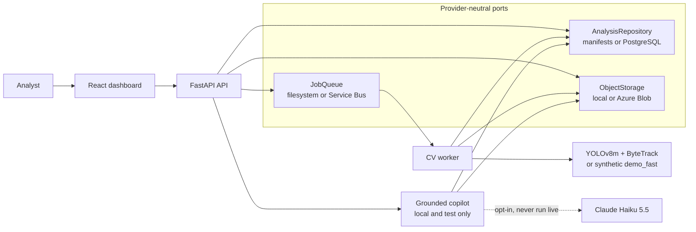
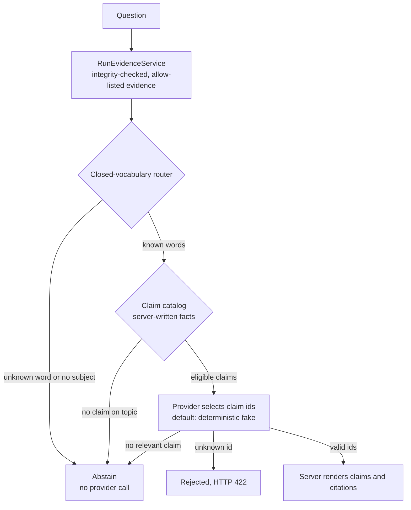
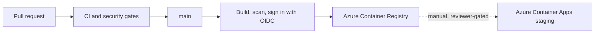

# Current verified architecture

| | |
|---|---|
| **Status** | Evidence snapshot of `main` at `2c83cb3` |
| **Owner** | Aziz Ben Ammar |
| **Evidence date** | 2026-11-01 |
| **Next review** | After M1, and before any diagram is exported |
| **Companion** | [Target architecture](ARCHITECTURE_TARGET.md) |

This page shows what exists. Nothing planned appears in these diagrams. The
planned design is in [ARCHITECTURE_TARGET.md](ARCHITECTURE_TARGET.md).

## Status labels

| Label | Meaning here |
|---|---|
| **IMPLEMENTED** | The code is on `main`. |
| **VERIFIED** | A test, CI job, or recorded run shows it working. |
| **DEPLOYED** | It ran in real Azure staging, with evidence. |
| **EXPERIMENTAL** | It exists for evaluation, and is not a product capability. |
| **PLANNED** | It does not exist. |
| **UNVERIFIED** | It could not be checked, or the last evidence is stale. |

## System overview

Read it in three parts: upload and analysis run asynchronously through a queue,
results are immutable and versioned, and the copilot reads finished runs without
changing them.

## Copilot request path

The model never writes a fact. It can only choose which server-written claims
answer the question, so it cannot invent a statistic. It can still choose claims
that do not answer the question, which is what the evaluation measures.

## Delivery path

## Component status

| Area | Component | Status | Evidence |
|---|---|---|---|
| Frontend | React dashboard, including Run Detail and explanation panel | IMPLEMENTED, VERIFIED | Frontend CI job on `2c83cb3` |
| Backend | FastAPI API with streaming upload, runs, retry, cancel, artifacts | IMPLEMENTED, VERIFIED | CI, split-plane integration job |
| Contracts | `footballai.analysis-run/v1`, immutable attempts, content-addressed artifacts | IMPLEMENTED, VERIFIED | `v2/contracts/`, contract tests |
| Storage | `AnalysisRepository`, `ObjectStorage`, `JobQueue` ports | IMPLEMENTED, VERIFIED | `v2/src/footballai_v2/storage/ports.py`, integration job |
| Cloud adapters | PostgreSQL, Azure Blob, Service Bus adapters | IMPLEMENTED, VERIFIED, DEPLOYED at last evidence | CI against PostgreSQL and Azurite; P4 staging validation |
| Worker | Long-lived worker with queue-driven stages | IMPLEMENTED, VERIFIED | Integration job |
| Computer vision | YOLOv8m detection plus ByteTrack (`v1_compat`) | IMPLEMENTED, VERIFIED **locally only** | 5, 15, 45 and 94-minute runs in [`reports/v2-validation`](../../reports/v2-validation/5m-15m-45m-94m-comparison.md) |
| Synthetic path | `demo_fast` deterministic placeholder output | IMPLEMENTED, VERIFIED, DEPLOYED at last evidence | Tests; the P4-proven cloud validation used this profile |
| Tracking diagnostics | AI1 cached detections, independent ByteTrack, `/v2` diagnostics | IMPLEMENTED, VERIFIED on a bounded clip | [`AI1_DETECTION_TRACKING.md`](../v2/AI1_DETECTION_TRACKING.md) |
| Identity research | AI2A evaluation layer | EXPERIMENTAL | Merged. It does not resolve identity |
| Identity research | AI2B appearance benchmark | EXPERIMENTAL, not merged | Open [PR #37](https://github.com/azizbenammar7/FootballAi/pull/37) |
| Copilot | Evidence service, router, claim catalog, citations, abstention | IMPLEMENTED, VERIFIED | 310 copilot tests passed, 1 skipped, run 2026-11-01 |
| Copilot | Deterministic fake provider | IMPLEMENTED, VERIFIED | It is not a language model, and the UI says so |
| Copilot | `AnthropicTextProvider` | IMPLEMENTED, UNVERIFIED live | Tested against the real SDK and a local server only |
| Evaluation | 52-case v1 harness and deterministic baseline | IMPLEMENTED, VERIFIED | Reproduced 2026-11-01 |
| Copilot | Dashboard question box and dataset v2 | IMPLEMENTED on `feat/copilot-interactive-m2a`, **not on `main` until merged** | M2-A pull request |
| Agent | Tool calling and agent loop | **IMPLEMENTED offline in M2-B, in review** | `v2/src/footballai_v2/copilot/agent/`. No endpoint reaches it, and no real model has run it |
| Agent | RAG, MCP, memory | **PLANNED, does not exist** | No such code on `main` |
| Observability | JSON logs, health and readiness endpoints | IMPLEMENTED, VERIFIED | `logging_config.py`, runtime health modules |
| Observability | Application Insights, metric alerts, OpenTelemetry instrumentation | EXPERIMENTAL, **not on `main`** | Draft [PR #20](https://github.com/azizbenammar7/FootballAi/pull/20), conflicting. Partly applied to staging from that branch |
| CI/CD | CI, Security, Build images on `main` | IMPLEMENTED, VERIFIED | All green on `2c83cb3`, including Build images run 41333208361 |
| Images | PR #50 images in ACR | VERIFIED pushed, **not deployed** | Build images run 41333208361 |
| Staging | Azure Container Apps, private PostgreSQL, Blob, Service Bus | DEPLOYED at last evidence, UNVERIFIED now | See below |

## What the cloud does and does not prove

- P4 proved image deployment, migration, readiness, and the split execution path
  in real Azure, using `demo_fast`. Real YOLO inference at full-match scale was
  only ever run locally, on Apple MPS.
- The copilot cannot run in staging. `CopilotSettings` refuses to enable it outside
  `local` and `test`, because the application has no authentication.
- Live Azure state could not be read on 2026-11-01 because the CLI session needs a
  fresh MFA sign-in. The last evidence is from 2026-09-05: older images on the API,
  worker, and migration workloads, PostgreSQL stopped, and P6 partially applied.
  Treat all of this as UNVERIFIED until it is read again.
- `main` has no Application Insights or alert resources in Terraform. Those exist
  only on the P6 branch.

## Scientific limits that any diagram or claim must respect

- Track IDs are temporary tracklets, not players. The 94-minute run produced 8,099
  raw track IDs, and 97.65% of raw tracks were too short to score.
- There is no ball tracking, pass, shot, possession, or tactical recognition.
- Distances use one pixel-to-metre constant with no homography. They are not
  verified physical distances.
- Fatigue and risk values are advisory heuristics, not clinical findings.
- `verified_real` means evidence corroborates that inference **ran**. It does not
  validate accuracy.
