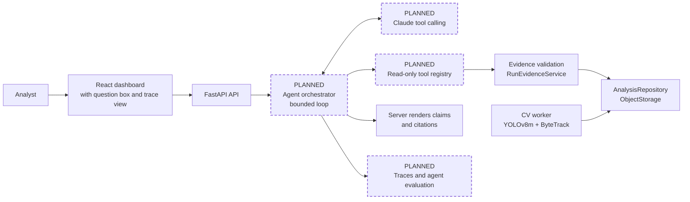
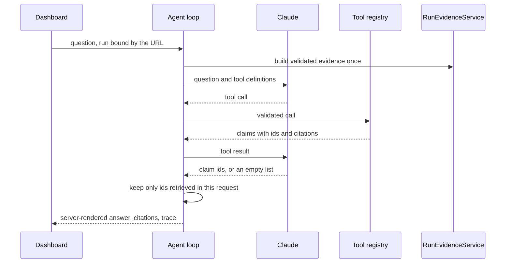

# Historical target architecture (2026-11-01)

> **Planning snapshot, not current system state.** The agent loop, five tools, local API route and trace viewer described below as planned have since merged. The real Anthropic path is implemented but unverified live. Use [the current architecture](ARCHITECTURE_CURRENT.md) and its status-labelled diagram for any portfolio or demo claim.

| | |
|---|---|
| **Status** | Partly built. M2-B implements the agent, tools, and trace offline, in review. No endpoint reaches them, and no real model has run them |
| **Owner** | Aziz Ben Ammar |
| **Date** | 2026-11-01 |
| **Depends on** | M1 result in the [roadmap](AI_ENGINEERING_ROADMAP.md) |
| **Decision needed** | Owner approval before M2 starts |
| **Companion** | [Current architecture](ARCHITECTURE_CURRENT.md) |

The goal is one read-only agent that decides which verified evidence to retrieve,
then answers only from what it retrieved. It builds on
[ADR-003](../v2/ADR-003-grounded-explanation-copilot.md), and keeps that record's
core rule: the model never writes a fact.

## Target diagram

Dashed nodes are the agent parts. M2-B builds the orchestrator, registry, and trace, tested
only against a stub. Claude tool calling, the API path to the agent, and the trace view
remain **PLANNED**. See [COPILOT_AGENT.md](../v2/COPILOT_AGENT.md) for what exists.

## Recommended decision

**Build one agent with a hand-written, bounded loop over the Claude Messages API,
in the existing `footballai_v2.copilot` package.**

| Option | Complexity | New dependency | Fit | Decision |
|---|---|---|---|---|
| **A. Manual bounded loop** | Low to medium | None beyond `anthropic` | Every limit, trace, and failure is ours to test | **Chosen** |
| B. SDK Tool Runner | Low | Beta API surface | Good loop, but limits and traces go through hooks on a beta helper | Revisit after M3 |
| C. LangGraph | Medium | Large | Solves branching workflows and checkpoints that this one-loop agent does not have | Rejected for now |
| D. MCP server | Medium | New process and protocol | Solves sharing tools across clients. There is one client | Rejected for now |
| E. Multi-agent swarm | High | Depends | No task here needs more than one agent | Rejected |
| F. Managed Agents | Medium | Hosted sandbox | Designed for workspaces and code execution, which this agent must not have | Rejected |

The trade-off is that option A means owning about a hundred lines of loop code. In
exchange, a stubbed model can drive the whole loop in CI, which is what keeps normal
CI deterministic and free.

LangGraph or MCP becomes worth adding only if a real need appears, such as durable
multi-step workflows or a second client that must share these tools.

## What runs in a request

## Tool set

Tools return **claims from the existing catalog**, never raw artifacts. Each claim
has an id, server-written text, and citations.

The agent receives the evidence for one run only. **No tool accepts a `run_id`.**
The server binds the run from the URL, so injected text cannot point the agent at
another run.

| Tool | Decision | Input | Returns | Source |
|---|---|---|---|---|
| `get_run_status` | Keep | None | `output_nature`, `run_status` | `ValidatedRunEvidence` |
| `get_tracking_diagnostics` | Keep | None | `diag_*` claims | Allow-listed `/v2` diagnostics |
| `get_artifact_metadata` | Keep | None | `artifact_integrity` | Registered artifacts with integrity state |
| `get_model_provenance` | Keep | None | `provenance`, `model_references`, `model_details`, `source_duration` | Run provenance |
| `get_evidence_limitations` | Add | None | `missing_evidence`, `boundaries` | Evidence limits |
| `get_analysis_manifest` | **Reject** | n/a | n/a | It would widen exposure past the allow-list, including input URIs |
| `compare_run_diagnostics` | **Defer** | n/a | n/a | Needs two `/v2` runs and a definition of when two runs are comparable |

Tools with empty inputs are deliberate. The interesting decision is which evidence
to fetch, not how to fill in parameters. `strict: true` guarantees schema-valid
calls.

## Controls

| Concern | Design |
|---|---|
| Validation | Strict tool schemas, then server validation of every name and input |
| Tool selection | Model-driven, `tool_choice: auto`. The prompt names the tools' purpose only |
| Maximum tool calls | 4 per question (proposed) |
| Maximum model turns | 5 per question (proposed) |
| Timeouts | 20 seconds per model call, as today, and a 45-second overall deadline (proposed) |
| Retries | None, matching the current provider |
| Tool errors | Fixed error code in a `tool_result` with `is_error: true`. Exception text never reaches the model |
| Limits reached | Fail closed with a new typed reason. No partial answer is shown |
| Refusal or truncation | Fail closed, as `provider_unavailable`. Haiku refusals have no server-side fallback |
| Thinking blocks | Full response content is appended unchanged on every turn |
| Authorization | The existing `local` and `test` gate stays. Tools can only read one run through `RunEvidenceService` |
| Grounding | Only claims returned by a tool in this request can be selected, and the server renders them |
| Citations | Citations come from the catalog and pass `validate_citations` |
| Abstention | An empty selection returns `no_relevant_claim`. The output-nature label always comes first |
| Traceability | Per-request trace: tool, status, latency, claim ids, tokens, stop reason, list-price estimate |
| State | Loop state only, in memory, for one request. No conversation store and no memory |
| Cost | Hard limits per question, and a budget guard for evaluation runs |

The model must never receive direct SQL access, shell access, Azure administration
capabilities, arbitrary filesystem access, or unvalidated artifact contents. There
is no code path for any of these: the registry is a closed list of five functions.

A follow-up question is a **new, independent request** on the same run. The UI can
show a thread, but the server remembers nothing between requests. This should be
stated plainly rather than presented as memory.

## Final output

The final turn returns `{"claim_ids": [...]}` through `output_config.format`, with
an enum listing the claim ids for this run. The server additionally rejects any id
that no tool returned in this request. That second check matters: it makes
retrieval part of the grounding chain rather than decoration.

Combining `output_config.format` with tools is documented but has not been tried
here. If an M2 live probe rejects it, the fallback is a terminal strict tool that
carries the same `claim_ids`.

## The closed-vocabulary router

The router blocks the flagship follow-up today. "How reliable was the tracking?"
abstains, because `reliable` is not a known word.

- Extend the vocabulary deliberately in M2, with evaluation cases. This needs no
  model.
- Keep the router in front of the agent. It stops unsupported football questions
  before any spend.

Relaxing the router so the model handles scope is a separate decision. It should
wait until evaluation shows that the agent abstains reliably.

## What this demonstrates

| Skill | Where it shows |
|---|---|
| Tool calling | Five strict, read-only tools with the model choosing among them |
| Agent orchestration | A bounded loop with typed stop conditions |
| Structured outputs | Schema-constrained final selection, then strict server parsing |
| State management | Loop state, tool-call ledger, and budget within one request |
| Grounding | Only retrieved, server-written claims can be published |
| Agent evaluation | Tool-selection, abstention, and adversarial metrics against a deterministic baseline |

## Security and failure risks

| Risk | Mitigation | Test |
|---|---|---|
| Prompt injection in the question | Question is untrusted data, and tools have no parameters to abuse | Adversarial cases |
| Injection through artifact text | Free text is dropped by the allow-list and never echoed | Existing malicious-artifact fixtures |
| Cross-run access | No tool takes a `run_id` | Schema test, adversarial cases |
| False supported answer | Measured against the deterministic baseline, with an acceptance rule set in advance | Decision rule |
| Label-only answer | Selecting only `output_nature` on a question that routes to the output topic currently produces an answer. `model-version` shows this. Fix in M2: require a non-label claim | Regression test |
| Runaway cost | Turn, tool, and time limits | Loop-limit tests |
| Public exposure | Gate refuses hosted environments | Existing gate tests |

## Consequences

- **Easier:** evidence, grounding, and citations are reused as they are.
- **Harder:** every new fact still needs a claim, citations, and vocabulary.
- **Not solved:** claims are as accurate as the CV output behind them.
- **Revisit:** a narrative, model-written answer needs its own decision and
  evaluation (option C in ADR-003). Do not add it for the demo.
- **Revisit:** retrieval (RAG) only if real unstructured material appears. Run
  evidence is structured, so vector search has no job here today.

## Before any hosted use

Authentication, per-run authorization, rate limits, per-user budgets, and secret
storage through managed identity are hard prerequisites. They are outside this
roadmap, so the target stays a local capability.
