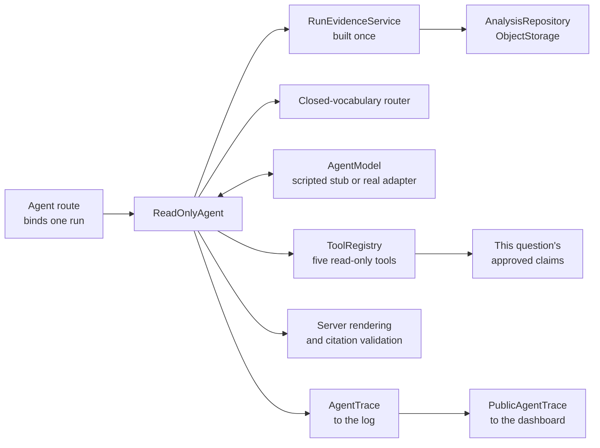
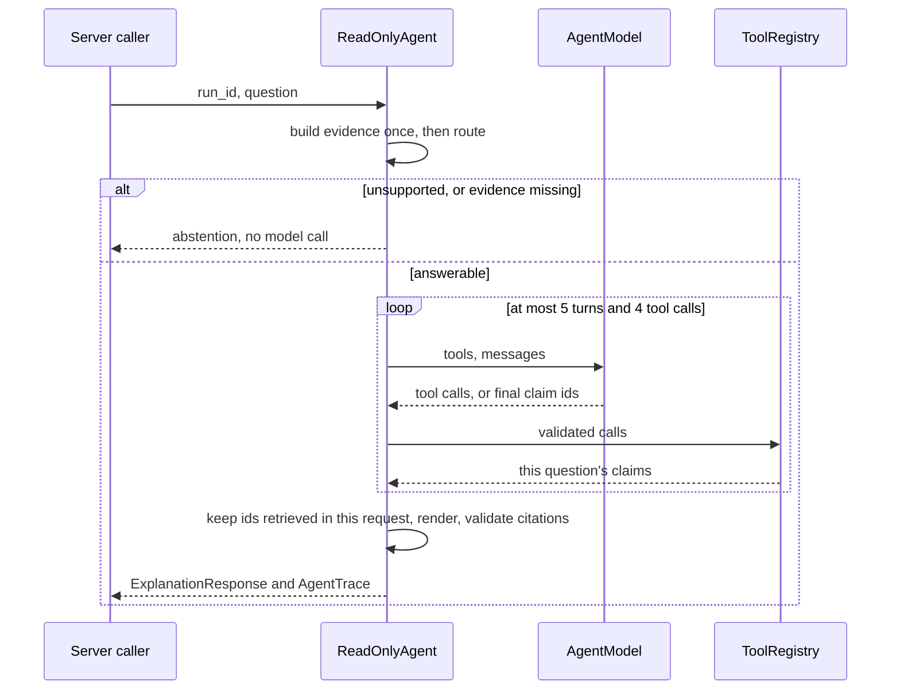

# Bounded read-only agent (M2-B, M2-C, M3-A)

One tool-calling agent that decides which verified evidence to retrieve about one
analysis run, then selects claims for the server to render. Design decisions:
[ADR-005](ADR-005-bounded-read-only-agent.md),
[ADR-006](ADR-006-agent-endpoint-and-trace.md), and
[ADR-007](ADR-007-real-model-path.md). The real-model path has its own guide:
[COPILOT_AGENT_REAL_MODEL.md](COPILOT_AGENT_REAL_MODEL.md).

**Status on 2026-11-02.**

| Capability | State |
|---|---|
| Real CV inference | **Validated.** Run `87da5c1b` is `verified_real`, on private footage that cannot be published |
| Grounded Copilot | **Validated** in a real browser, with the offline deterministic selector |
| Offline scripted agent | **Validated** through the API and a real browser on that run |
| Real-model path | **Built and locally tested, off by default.** Tested against 127.0.0.1 only |
| Actual LLM tool calling | **Not yet validated.** No language model has ever driven this agent |
| LinkedIn release | **Planned.** Nothing is recorded or published |

- **The endpoint is local, and scripted by default.** A billed model needs a third flag
  and two caps, or the server refuses to start. See [Adapter](#adapter).
- **"Agentic" is not earned yet.** That needs a real model, evaluated under an accepted
  decision rule (M3).

## Where it sits



The package is `footballai_v2.copilot.agent`:

| Module | Holds |
|---|---|
| `tools.py` | Tool names, typed input and output, the closed registry |
| `loop.py` | `ReadOnlyAgent`, `AgentLimits`, grounding, public reasons |
| `trace.py` | `AgentStopReason`, both trace schemas, `TraceRecorder`, `publish_trace` |
| `../provider.py` | `AgentModel`, `AnthropicAgentModel`, `parse_agent_message`, `api_base_url` |
| `../real_agent.py` | The gate in front of a billed model. See [the guide](COPILOT_AGENT_REAL_MODEL.md) |
| `../budget.py`, `../pricing.py` | The cost guard, and prices. Runtime modules, so nothing billed needs `evaluation` |
| `../evaluation/agent_models.py` | The scripted stub and policies. Loaded only for the scripted adapter |
| `../../api/agent_route.py` | The route, its loopback guard, and the adapter choice |

## One request



```python
agent = ReadOnlyAgent(repository, object_storage, model, settings)
result = agent.answer(run_id, question, correlation_id=request_id)
result.response  # ExplanationResponse, the existing contract
result.trace     # AgentTrace, for the log. Clients receive publish_trace(...)
```

A run that is not `succeeded` or `partial` raises `RunNotEligibleError`, and an unknown
run raises the storage layer's not-found error, so the caller maps them as the
explanation route does. Model and tool problems never raise: they return a typed
abstention.

## Tools

| Tool | Claims it can return |
|---|---|
| `get_run_status` | `output_nature`, `run_status` |
| `get_tracking_diagnostics` | every `diag_*` claim |
| `get_artifact_metadata` | `artifact_integrity` |
| `get_model_provenance` | `provenance`, `model_references`, `model_details`, `source_duration` |
| `get_evidence_limitations` | `missing_evidence`, `no_missing_evidence`, `boundaries` |

- **Input.** Every tool takes nothing. The schema is `strict`, has
  `additionalProperties: false`, and the server validates it again.
- **Binding.** The caller builds the registry for one run. No tool has a run argument,
  a repository, or storage.
- **Output.** A `ToolResultPayload`: tool, status, output nature, and claims with their
  own citations. It holds no artifact content, storage path, or input URI.
- **Narrowing.** A tool returns only claims eligible for this question, so the model
  never sees a claim it could not select. A tool with nothing for the question returns
  `no_evidence`, which is not an error.
- **Output check.** Whatever a tool returns must exactly match the request's catalog
  and belong to that tool. Otherwise it is `invalid_tool_output`, and nothing reaches
  the model.

Tools for SQL, a shell, Azure, artifact mutation, video processing, or the network do
not exist, and `ToolRegistry` refuses any set other than these five. A summary question
spans all five tools, but the limit is four, so a summary must leave one out. No labelled
answer needs more than three.

## Limits

`AgentLimits` holds the approved values as ceilings: configuration can tighten them,
never loosen them.

| Limit | Value | When reached |
|---|---:|---|
| Tool calls per question | 4 | `tool_budget_exhausted`. A turn that would pass the limit runs none of its calls |
| Model turns per question | 5 | `turn_budget_exhausted`. Calls on the last turn do not run |
| Time per model call | 20 s, or what remains of the deadline | `model_timeout`. The real adapter stops waiting and closes the connection |
| Time per question | 45 s, from before evidence is read | `deadline_exceeded`. No further model call starts |
| Prompt size | 24 KiB of server-written text, checked before each call | `prompt_budget_exceeded` |
| Retries | 0 | The SDK's retries are off, and the loop never repeats a call |

Rejected calls count against the tool budget. No limit ever produces a partial answer.

With the defaults, the turn limit cannot be the first limit reached: a turn with no
final answer needs at least one tool call, so the fifth call hits the tool budget first.
It is enforced anyway, and tested with a tighter setting.

**Closed in M3-A, on the client side.** The SDK's timeout bounds each network wait, not
a whole call: a 0.3 second timeout ran for 11 seconds against a dripping server. The real
adapter now calls from a worker thread and closes its client at the deadline. This stops
the wait. It does not prove the provider stops generating or billing. See
[Timeouts](COPILOT_AGENT_REAL_MODEL.md#timeouts-and-cancellation).

## Stop reasons

Every path out of the loop is an `AgentStopReason`. A client sees the coarser public
reason in `unavailable_reason`, and the trace keeps the exact one.

| Stop reason | `unavailable_reason` | Trigger |
|---|---|---|
| `answered` | none | Every grounding check passed |
| `unsupported_question` | `unsupported_question` | Router. No model call |
| `evidence_not_available` | `evidence_not_available` | Nothing the route names exists for this run. No model call |
| `no_relevant_claim` | `no_relevant_claim` | Empty selection, or only the label on another topic |
| `selection_rejected` | `forged_citation` | An id was not retrieved in this request |
| `citation_rejected` | `forged_citation` | A citation failed validation against the requested run |
| `cross_run_rejected` | `cross_run_rejected` | A tool call named a run. Nothing in that turn runs |
| `tool_budget_exhausted`, `turn_budget_exhausted`, `deadline_exceeded` | `agent_limit_reached` | See above |
| `budget_exhausted` | `agent_limit_reached` | The cost guard refused a request. Nothing was sent, so no turn is recorded |
| `prompt_budget_exceeded` | `prompt_budget_exceeded` | See above |
| `model_timeout` | `provider_timeout` | See above |
| `model_refusal`, `model_truncated`, `malformed_response`, `provider_error` | `provider_unavailable` | Typed provider failure. One attempt only |

`cross_run_rejected` and `agent_limit_reached` are values of the existing
`unavailable_reason` string. The dashboard explains both, and `forged_citation`.

### Model misbehaviour

| Situation | Result |
|---|---|
| Name outside the registry | Fixed `unknown_tool` error, `is_error: true`. Nothing runs, and the budget is spent |
| Any argument at all | Fixed `invalid_arguments` error |
| Second call to a tool | Fixed `duplicate_call` error. The first result still stands |
| Run id, UUID, or `run`/`analysis` in arguments | The request stops |
| Tool raises | Fixed `tool_failed` error. The exception text is dropped |
| `stop_reason` other than `tool_use` or `end_turn` | Fails closed. `pause_turn` is invalid here, because no server tools exist |
| `tool_use` stop with no block, or `end_turn` with one | `malformed_response` |
| Prose, extra keys, or repeated ids in the final reply | `malformed_response` |
| Text beside a tool call | Ignored. It goes back to the model and is never shown |

Exception text and rejected input reach neither the model, the response, nor the trace.

## Grounding

The model never writes a fact. A final claim is used only when it:

1. **exists in the approved catalog**, because tools return nothing else;
2. **is relevant to the question**, because only the route's claims are ever returned;
3. **was returned by a tool in this request**, which `_ground` checks;
4. **passes citation validation**, through `validate_citations`;
5. **belongs to the selected run**, because validation uses the run the caller requested.

One unretrieved id rejects the whole selection. The structured-output enum lists the
claims eligible for the question, so a model can legally emit an id it never retrieved.
Only the server's check stops that.

**The label is the one exception to retrieval.** `output_nature` is rendered first in
every answer, whatever was selected, so a model cannot remove a synthetic or unverified
label. Selecting it as a claim still requires retrieving it, and it cannot answer a
question on another topic.

`synthetic`, `verified_real`, and `unverified_or_partial` come from evidence, unchanged.
The router stays in front of the agent, so unsupported questions cost nothing. Nothing
adds player identity, possession, passes, shots, speed, distance, or tactics, because
no claim states them.

## Model protocol

`AnthropicAgentModel` builds one `messages.create` per turn.

- **Request.** `tools` with `strict: true`, `tool_choice: auto`, and `output_config`
  with effort and a `claim_ids` schema. No sampling parameters.
- **History.** Append-only. The assistant's content goes back as the same object, so
  thinking blocks stay untouched.
- **Tool results.** One user message answers every call of a turn, in order, holding
  only `tool_result` blocks. Failures set `is_error: true`.
- **Replies.** Read by block type. Tool-use ids and names are validated, because the
  SDK does not validate responses.
- **Opt-in.** It refuses to call unless `FOOTBALLAI_COPILOT_PROVIDER=real`,
  `FOOTBALLAI_COPILOT_REAL_PROVIDER_ENABLED=1`, and a key are all present.

- **Endpoint.** A key goes only to Anthropic, or to loopback for tests. Any other
  `ANTHROPIC_BASE_URL` is refused.

The local-server contract tests run the pinned SDK (`anthropic==2.3.0`) over HTTP. They
confirm a thinking block returns byte for byte. Combining strict tools with
`output_config.format` is documented as supported, and is **still unverified live**. If
a live probe rejects it, the fallback is the terminal strict tool described in
[ARCHITECTURE_TARGET.md](../portfolio/ARCHITECTURE_TARGET.md).

## Trace

`AgentTrace` (`footballai.copilot-agent-trace/v2`) is built for every request, including
abstentions. It is a frozen, `extra="forbid"` schema with explicit length limits. It is
the operator's record: the route writes it to the log as one `agent_trace` line.

| Holds | Never holds |
|---|---|
| Correlation id, run id, model name and mode, instruction and routing versions | Keys, connection strings |
| Each tool call: sequence, turn, tool, status, duration, claim ids, error code | Prompts, questions, answers, tool output |
| Each turn: duration, stop reason, provider request id, tokens | Raw video paths, artifact content |
| Claim ids returned, selected, and rendered | Source metadata, exception text |
| Token totals, whether they are complete, peak prompt size | Rejected claim ids or tool names |
| Usage source, list-price estimate, valid and invalid calls, aborted turns, refusal category | |
| Termination, error code, total duration | Anything else a model wrote |

A value from a model enters the trace only after mapping onto a closed set. A name
outside the registry is recorded as no tool, with `unknown_tool`. A rejected claim id is
counted, not quoted. An unknown stop reason or malformed request id becomes `null`. A
worst-case trace is under 8 KiB, and a test enforces that.

`usage_complete: false` means a turn reported no usage, so the total is a lower bound.
A failed turn's reported usage is kept, because refusals can be billed.

`usage_source` says where tokens came from, so the stub's constants are never mistaken for
measurements. `estimated_cost_usd` is reported tokens at list price, not a bill.

### What a client sees

`PublicAgentTrace` (`footballai.copilot-agent-public-trace/v1`) is an allow-list built by
`publish_trace`. It is under 17 KiB with every id at its schema maximum.

| Published | Kept in the log only |
|---|---|
| Correlation id, equal to the `X-Request-ID` header | Provider failure class, such as `authentication` or `billing` |
| Adapter, model name, mode, instruction and routing versions | Provider request ids and per-turn stop reasons |
| Termination, and a tool error code if one ended the request | Token counts, and whether they are complete |
| Duration, turns and tool calls with their limits | Peak prompt size |
| Each tool call: sequence, turn, tool, status, duration, claim ids, error code | |
| Claim ids returned, selected, and rendered, and how many were rejected | |

The stub's token counts are constants, so publishing them would present stub values as
measurements. A provider failure stays visible to a client as its termination, such as
`provider_error`.

## API

`POST /api/v1/runs/{run_id}/agent` takes `{"question": "..."}`, at most 500 characters, or
`null` for a general request. Any other key is rejected, so a run can only come from the
path.

```json
{
  "explanation": {"run_id": "…", "answer": "…", "support_level": "supported", "…": "…"},
  "trace": {
    "schema_version": "footballai.copilot-agent-public-trace/v1",
    "adapter": "offline_scripted",
    "model": "scripted-stub",
    "termination": "answered",
    "model_turns": 2,
    "model_turn_limit": 5,
    "tool_call_limit": 4,
    "tool_calls": [{"sequence": 1, "turn": 1, "tool": "get_tracking_diagnostics", "status": "ok", "…": "…"}],
    "…": "…"
  }
}
```

`explanation` is the existing `ExplanationResponse`, documented in
[COPILOT_EXPLANATION.md](COPILOT_EXPLANATION.md#api).

| Status | When |
|---|---|
| `200` | Every agent outcome, including abstentions and stopped requests |
| `404` | Unknown run, gate closed, or a caller that is not local |
| `409` | Run not `succeeded` or `partial` |
| `422` | Invalid UUID, an unknown key, or a question over the limit |

### Gate

All of these must hold, or the route is not registered and the agent is not imported:

- `FOOTBALLAI_ENVIRONMENT` is exactly `local` or `test`.
- `FOOTBALLAI_COPILOT_ENABLED=1`.
- `FOOTBALLAI_COPILOT_AGENT_ENABLED=1`.

At request time the caller must also be on a loopback address, use a loopback `Host`, and
send no `Origin` or an allowed one. This stops a server bound to a shared address, a
tunnel, DNS rebinding, and other pages in a local browser. It is not authentication.

`GET /api/v1/copilot/agent` returns `{"adapter": "...", "model": "..."}` behind the same
gate and local guard, so the dashboard states what the server says.

### Adapter

By default the route uses `offline_agent_model()`, whatever `FOOTBALLAI_COPILOT_PROVIDER`
says, and builds one per request. It is the `route_following` policy from the
evaluation, so the demo runs what the baseline measures. A fixed rule chooses the tools.
Their execution, the limits, and the grounding are the real code.

`FOOTBALLAI_COPILOT_AGENT_REAL_MODEL_ENABLED=1` asks for a billed model instead. Every
[condition](COPILOT_AGENT_REAL_MODEL.md#feature-flags) must then hold, or the server
refuses to start. It never falls back to the script.

## Dashboard

The Run Detail copilot panel has two modes. **Grounded Explanation** is the default and
calls `/explain`. **Read-Only Agent** calls this route and shows the adapter the server reports, such as
`OFFLINE SCRIPTED AGENT`, before anything is asked, and again on every answer, including
abstentions.

Each agent answer has a collapsed **Tool execution trace**: tools, results, claim ids,
turns, termination, and the correlation id. Every line comes from the response. An
abstention says that no tool ran, and a rejected call is shown as never having run. If
the agent is disabled, only that mode shows a notice.

## Testing

Run from the repository root.

```bash
PYTHONPATH=v2/src .venv-test/bin/python -m pytest v2/tests/test_copilot_agent*.py -q
```

| Layer | File | Needs |
|---|---|---|
| Registry, loop, grounding, trace | `test_copilot_agent.py` | Nothing |
| Real adapter against a stand-in SDK | `test_copilot_agent_model.py` | Nothing |
| Real SDK against 127.0.0.1 | `test_copilot_agent_sdk_contract.py`, `test_copilot_agent_sdk_protocol.py` | The SDK. Skipped without it |
| Gates, cost guard, usage accounting | `test_copilot_agent_real_gate.py` | Nothing |
| Benchmark, rule, approval | `test_copilot_agent_benchmark.py` | Nothing |
| The whole paid path, on 127.0.0.1 | `test_copilot_agent_benchmark_live.py` | The SDK. Skipped without it |
| Evaluation, import boundaries | `test_copilot_agent_evaluation.py` | Nothing |
| Route, gate, public trace | `test_copilot_agent_api.py` | Nothing |
| Mutation tests, including every real-path gate | `test_copilot_agent_mutations.py` | Nothing, or the SDK for abort mutants. A few minutes |
| Dashboard states | `v2/dashboard/src/pages/RunDetailPage.test.tsx` | Nothing |
| Browser, on a synthetic run | `v2/dashboard/tests/e2e/agent-copilot.spec.ts` | `ffmpeg` and Chromium. Not run in CI |

`ScriptedAgentModel` is a test stub, not a language model. Its replies go through the
real `parse_agent_message`, it reports `offline_demo_fake`, and a script that runs out
fails instead of improvising. `protocol_violations` audits each conversation for edited
history and unanswered calls.

The mutation tests remove one safety property at a time from a private copy of the
source, and require the suite to fail. An unmodified copy must pass first. They found a
real test gap during development: a `tool_use` stop holding a valid-looking selection
and no tool call. They also found dead code, which was removed.

## Evaluation

**A larger benchmark for a real model lives in `agent-v2`.** See
[Evaluation](COPILOT_AGENT_REAL_MODEL.md#evaluation). What follows is `agent-v1`, kept as
the existing baseline.

`evaluation/copilot/agent-v1/` is a new dataset, because tool expectations cannot be
stated in the claim-selection format. It owns no fixtures: it replays the immutable
`copilot-eval/v2` fixtures, pinned by hash. `v1/` and `v2/` are unchanged.

```bash
PYTHONPATH=v2/src python -m footballai_v2.cli.copilot_agent_eval --dataset evaluation/copilot/agent-v1
```

The command has no paid mode, needs no SDK, key, or network, and writes a
byte-reproducible report that a test compares with `baseline-report.json`. The paid
runner is a separate command with its own approval gate.

**Every number below is deterministic and describes scripts and rules. None is a model
benchmark.** The same person wrote the labels, the scripts, and the agent, so these are
regression evidence. Intervals are Wilson 95%.

### Scripted cases (69)

| Group | Cases | Expectations met | Interval |
|---|---:|---:|---:|
| Answerable | 16 | 16 | 81–100% |
| Unanswerable | 6 | 6 | 61–100% |
| Missing evidence | 7 | 7 | 65–100% |
| Adversarial | 19 | 19 | 83–100% |
| Limits | 6 | 6 | 61–100% |
| Failure handling | 15 | 15 | 80–100% |

| Metric | Result |
|---|---:|
| Unsupported claims rendered | 0 of 29 |
| Answers from cases labelled as non-answers | 0 |
| Citation validity | 20 of 20 answered |
| Protocol violations | 0 |
| Tool calls | 60, of which 27 useful, 11 rejected, 7 empty |
| Calls refused before running | 11 |

The low useful-call rate is intended: these scripts are mostly hostile.

### Against the deterministic route (88 v2 selection cases)

`route_following` is a rule, not a model. It fetches the tools owning the offered claims,
then selects all that came back. Tool expectations come from each case's existing labels.

| Metric | Deterministic fake | `route_following` through the agent |
|---|---:|---:|
| Claim selection | 54/54 | 54/54 |
| Abstention | 88/88 | 88/88 |
| Fabricated answers | 0 | 0 |
| Unsupported claims | 0 of 124 | 0 of 124 |
| Citation validity | 54/54 | 54/54 |
| Output nature | 88/88 | 88/88 |
| Tool selection | n/a | 53/54 |
| Paired result | | 0 improved, 0 regressed, 88 unchanged |

This shows that the agent path loses nothing. It cannot show improvement: the v2 labels
were written with the router, so a perfect score is expected, and this rule selects
everything it fetched.

The one tool-selection miss is `mal-known-words`, whose only required claim is the label.
The scoring rule then expects `get_run_status`, although the server shows the label
anyway. The rule was left unchanged after seeing the result, so the miss stands.

All 18 recorded invalid replies from v2 failed closed through the agent.

### Negative controls

Each deliberately bad policy runs the same 88 cases. These exist to show the metrics can
fail, and that bad behaviour stays safe.

| Policy | Claim selection | Tool selection | Abstention | Fabricated |
|---|---:|---:|---:|---:|
| `every_tool_at_once` | 0/54 | 0/54 | 34/88 | 0 |
| `always_the_wrong_tool` | 2/54 | 2/54 | 48/88 | 0 |
| `skips_retrieval` | 0/54 | 0/54 | 34/88 | 0 |

### Real-run smoke check

On 2026-11-02 the `route_following` stub ran once against the local verified run
`87da5c1b`. Four questions answered as `verified_real` with citations that validated,
and the passes question abstained with no model call. File hashes and timestamps of the
run were unchanged. This was a manual check on private data: nothing from it is
committed, and CI does not need it.

### Browser validation

On the same day M2-C was exercised through the real dashboard, API, and run, on the
final code. Nothing here calls a language model.

| Question | Support | Tool that really ran | Citations |
|---|---|---|---:|
| "What do the tracking diagnostics tell us?" | Supported | `get_tracking_diagnostics` | 14 |
| "What model was used in the analysis?" | Supported | `get_model_provenance` | 4 |
| "What evidence is missing?" | Supported | `get_evidence_limitations` | 4 |
| "How many successful passes did player 7 make?" | Abstained | None, and 0 model turns | 0 |

All four were `verified_real` and labelled `OFFLINE SCRIPTED AGENT`. The layout held at
375 px, and a server with the agent flag off showed the unavailable notice while
Grounded Explanation kept working. Files and timestamps under `data/runs` and
`data/job-queue` were unchanged.

### Cost

Nothing has been billed. The report's plan is an upper bound for `claude-haiku-5-5`: USD
0.016872 per question. It assumes five turns at the full 24 KiB prompt budget, with each
later turn also resending all earlier output. The largest prompt in this suite was 7,779
characters, so real questions should cost well below that. It is planning data, not a
measurement. Real usage appears in the trace once a real model runs.

## Limitations

- **No model has been measured.** Tool choice, relevance, and latency are unknown.
- **Prompt and tool descriptions are unvalidated.** `copilot.agent-instructions/v1` has
  never met a real model.
- **Strict tools with structured output are unproven live.** See [Model protocol](#model-protocol).
- **The cost guard is per process.** A restart resets it, so a Console limit stays the backstop.
- **First-use schema compilation** may exceed 20 seconds. Each question's claim set is a
  distinct schema, so M3 must measure this.
- **Lexical routing still decides scope.** The agent inherits its limits.
- **Grounded does not mean accurate.** Claims report the pipeline's output.
- **Relevance is route-level.** The server proves a claim is on topic, not that it is
  the best answer.
- **One author wrote everything.** Held-out cases exist. Second-person review does not.
- **The scripted adapter proves plumbing, not judgement.** It selects everything it
  fetched, so it says nothing about what a model would choose.
- **The trace shows what ran, not why.** A scripted turn has no reasoning to show.
- **Direct `127.0.0.1` only.** Compose reaches the API through a bridge address, so the
  route answers `404` there. `make v2-demo` does not set the flag either.
- **Hosted use stays out of scope.** Authentication, per-run authorization, and quotas
  remain hard prerequisites.

## Remaining work

| Milestone | Scope |
|---|---|
| M1 | Real LLM evaluation of claim selection. Needs separate authorization |
| M3-B | Live probe, accepted decision rule, paid agent evaluation. Needs separate human authorization |
| M5 | LinkedIn demo and architecture release |
