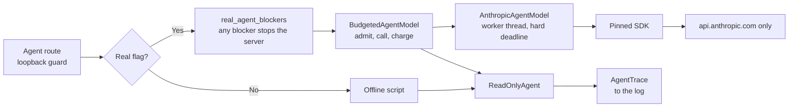

# Real-model readiness for the agent (M3-A)

What it takes to point the [bounded agent](COPILOT_AGENT.md) at a real Anthropic model,
and what has and has not been proven. Design decisions:
[ADR-007](ADR-007-real-model-path.md). Rule and approval:
[COPILOT_AGENT_DECISION_RULE.md](COPILOT_AGENT_DECISION_RULE.md).

**Status on 2026-11-02.** The path is built and tested against a local server with the
pinned SDK. **No request has been sent to Anthropic, no model has driven this agent, and
real model quality is unmeasured.** Every test here runs on 127.0.0.1.

## Audit

What already worked, and what M3-A had to add. Each gap was checked by running code.

| Area | Found | Result |
|---|---|---|
| Protocol | One `messages.create` per turn, append-only history, ordered results | Kept. Now tested far more widely |
| Tool-use sequencing | Stop reason checked before any tool runs | Kept. Tested with truncated and refused tool calls |
| Structured output | Enum of offered ids, strict server parsing | Kept |
| Typed errors | Status codes and SDK classes mapped | Kept. Added a closed refusal category |
| **Whole-call timeout** | **Not a deadline.** A 0.3 s timeout ran for 11.06 s against a dripping server | **Fixed**, with a worker thread and client close |
| **Cancellation** | None | Client side only. See [Timeouts](#timeouts-and-cancellation) |
| **Endpoint** | The SDK follows `ANTHROPIC_BASE_URL` silently, and it was set in this environment | **Fixed** for the agent. M1 paths unchanged |
| **`/explain` beside the agent** | The agent's provider setting also billed `/explain`, unguarded | **Fixed.** `/explain` stays offline beside the real agent |
| **Token accounting** | Stub constants looked the same as measurements | **Fixed** with `usage_source` |
| **Cost** | None at runtime, and pricing lived in `evaluation` | **Fixed.** `copilot/pricing.py`, `copilot/budget.py` |
| **Concurrent spend** | The guard checked spent money, not money in flight | **Fixed** with reservations |
| Budget refusals | Recorded as a model turn, so a refused request looked sent | **Fixed.** No request means no turn |
| **Dashboard banner** | Hard-coded `OFFLINE SCRIPTED AGENT`, which would be false | **Fixed.** The server reports the adapter |
| Cross-run isolation | No tool takes a run, and citations are checked against the requested run | Kept. Tested on the wire |
| Runtime imports | The route loaded the script's module on every path | **Fixed.** The real path imports nothing from `evaluation` |
| **`no_missing_evidence`** | Offered on a run whose short-tracklet block was refused as malformed, while saying the diagnostics are "valid" | **Fixed.** Withheld when a measure was refused |
| Trace | Good, but no cost, source, or summary counts | Extended to `footballai.copilot-agent-trace/v2` |

**`no_missing_evidence` scope.** It says the evidence checks recorded nothing missing,
and that this covers evidence FootballAI reads. It never says that a run's model is
recorded. So on a run with no model reference, "Is any model evidence missing?" needs
`model_references` too. The labelled case `gap-model-evidence` requires that, because a
model selecting the gap claim alone would mislead.

## Architecture



| Module | Holds |
|---|---|
| `copilot/real_agent.py` | `real_agent_blockers`, `real_agent_factory` |
| `copilot/budget.py` | `BudgetGuard`, `BudgetedAgentModel`, `turn_worst_case_usd` |
| `copilot/pricing.py` | Prices and upper bounds |
| `copilot/provider.py` | `AnthropicAgentModel`, `api_base_url` |
| `copilot/evaluation/agent_benchmark.py` | Dataset, scorer, policies |
| `copilot/evaluation/agent_llmops.py` | Trace summaries |
| `copilot/evaluation/agent_rule.py` | Decision rule calculation |
| `copilot/evaluation/agent_live.py` | Approval checks, preflight, live runner |
| `cli/copilot_agent_benchmark.py` | The command |

Grounding did not change. The model selects tools and claim ids, and the server renders
every sentence. Tools take no input and cannot name a run. The five tools are the same
five, and no SQL, shell, filesystem, network, or Azure capability exists.

## Feature flags

**Default: off.** The offline script stays the default, and behaves as it did.

| Variable | Needed value |
|---|---|
| `FOOTBALLAI_ENVIRONMENT` | `local` or `test` |
| `FOOTBALLAI_COPILOT_ENABLED` | `1` |
| `FOOTBALLAI_COPILOT_AGENT_ENABLED` | `1` |
| `FOOTBALLAI_COPILOT_PROVIDER` | `real` |
| `FOOTBALLAI_COPILOT_REAL_PROVIDER_ENABLED` | `1` |
| `FOOTBALLAI_COPILOT_AGENT_REAL_MODEL_ENABLED` | `1`, the new key |
| `FOOTBALLAI_COPILOT_AGENT_MAX_REQUESTS` | 1 to 200. Billed model calls for this process |
| `FOOTBALLAI_COPILOT_AGENT_MAX_COST_USD` | Above 0, at most 5 |
| `ANTHROPIC_API_KEY` | Server environment only. Never a file or the dashboard |

With the real flag set, any blocker stops the server from starting. It never falls back
to the script.

| Blocker | Meaning |
|---|---|
| `provider_not_real` | The provider settings are missing |
| `hosted_environment` | Azure Container Apps, App Service, or Kubernetes markers are present |
| `continuous_integration` | `CI` or `GITHUB_ACTIONS` is set |
| `missing_api_key` | No key in the server's environment |
| `unapproved_api_endpoint` | `ANTHROPIC_BASE_URL` is not Anthropic or loopback |
| `unpriced_model` | The model has no verified price |
| `no_request_cap`, `no_cost_cap` | A cap is missing, invalid, or over its ceiling |
| `sdk_not_installed` | No runtime image contains the SDK, so use a local environment |

**Still in force:** loopback peer, loopback `Host`, allowed `Origin`, and one adapter per
request. `/explain` stays offline while the real agent is on, because it has neither
guard. No image, Terraform file, or workflow sets any of these variables, and tests
enforce that.

## Anthropic protocol

Checked on 2026-11-02 against current documentation and the pinned `anthropic==2.3.0`.

| Item | Repository | Documentation | State |
|---|---|---|---|
| Model id | `claude-haiku-5-5` | Listed. Retirement not before 2027-10-07 | **Verified in docs. UNVERIFIED LIVE** on this account |
| Prices | $0.10 / $0.50, cache $0.125 / $0.01, ×5 above 100k tokens | Same | Verified in docs |
| `output_config.format` | JSON schema with an enum | Supported on this model | Verified in docs. **UNVERIFIED LIVE** |
| Strict tools with structured output | Both, in one request | "Can be used together" | Verified in docs. **UNVERIFIED LIVE** |
| Strict tool with no properties | `properties: {}`, `additionalProperties: false` | Not stated either way | **UNVERIFIED** |
| `tool_choice: auto` | Used | Fine. Forced choice is a 400 on Sonnet 5.5 and Opus 5.5, though not Haiku 5.5 | Verified in docs |
| Effort `low` | Used | Default on Haiku 5.5 is `medium` | Verified in docs. **UNVERIFIED LIVE** |
| Thinking | Not set | Adaptive by default, and counts toward `max_tokens` | **Risk.** A 1024 cap could truncate. Measure it |
| Sampling parameters | None | 400 on the SDK's API version | Verified in docs |
| `fallbacks` | Not sent | Haiku 5.5 has no server-side fallback | Verified in docs. Deliberate: a silent model switch would invalidate a measurement |
| Enum casing | Exact match | Casing is not guaranteed | Small risk. A mismatch fails closed, and counts against the model |
| Grammar compilation | 20 s turn limit | Cached 24 hours, 180 s compile limit | **Risk.** See [the rule](COPILOT_AGENT_DECISION_RULE.md#why-8-seconds-is-provisional) |
| Empty `end_turn` after tool results | Fails closed, never retried | Documented as possible. Sending only `tool_result` blocks avoids its common cause | Handled |
| Preserved thinking | History is append-only, and thinking goes back unchanged | Required | Tested locally. **UNVERIFIED LIVE** |

### What is unverified live

Nothing above has met the real API. The documentation says it should work. It does not
prove that it does for this account, this model, and these schemas together. Stage B of
the [runbook](#m3-b-runbook) exists to find out for a few cents.

### Protocol tests

`test_copilot_agent_sdk_protocol.py` drives the pinned SDK over HTTP to 127.0.0.1, so the
SDK does its own serialization and parsing.

| Covers | Examples |
|---|---|
| Tool use | Two calls in a turn, calls across turns, append-only history, redacted thinking returned unchanged |
| Tool results | Order, one user message, `is_error`, fixed error text |
| Final selections | Rendered by the server, schema offers only this question's claims |
| Invalid replies | Duplicates, extra fields, wrong types, empty `end_turn` |
| Invalid tool calls | No id, no name, repeated ids, a call with a finishing stop, unknown names, any argument, run references |
| Budgets | Tool budget within and across turns, money guard between turns |
| Timeouts | Silent server, dripping server, question deadline |
| Networks | Closed port, connection cut mid-body |
| Malformed bodies | Truncated JSON, empty body, a JSON array |
| Stop reasons | `pause_turn`, `stop_sequence`, unknown, `max_tokens`, context window |
| Refusals | Category kept on a closed set, explanation discarded, partial tool call not run |
| Usage on failure | Refusal, truncation, prose, malformed reply, later-turn failure, malformed counts |
| Route | Billed adapter through FastAPI, request cap across questions, `/explain` stays offline |

A local server proves the client side only. It cannot show that the real API accepts
these requests, or how a real model behaves.

## Timeouts and cancellation

**Question investigated:** are slow calls really cancelled, or only timed out by the
caller?

| Measured against a local dripping server, 0.3 s deadline | Result |
|---|---|
| SDK timeout alone | Caller blocked 11.06 s. The timeout bounds each read, not the call |
| Worker thread, then client close | Caller back at 0.31 s |
| Server saw the connection close | 0.38 s |
| Worker thread ended | 0.57 s |

Tests hold each of these, and mutation tests show they fail without the abort.

**What can be claimed:** the caller's deadline is hard, the local connection is closed,
and the thread ends.

**What cannot be claimed:** that Anthropic stops generating, or does not bill. **This is
not hard cancellation of the provider's work.** So an aborted turn is recorded with
`aborted: true` and no usage, makes the trace a lower bound, and is charged at its worst
case by the guard.

## Cost and token accounting

| Term | Meaning | Where |
|---|---|---|
| Actual usage | Tokens the provider reported | `AgentTrace.usage`, per turn and in total |
| `usage_source` | `provider_reported`, `unavailable`, `scripted_constant`, or `not_called` | `AgentTrace` |
| Estimated cost | Actual usage at list price. **Not a bill** | `estimated_cost_usd` |
| `cost_is_lower_bound` | A turn reported no usage, so the estimate is too low | `AgentTrace` |
| Worst case | The most a request can cost. Reserved before sending | `turn_worst_case_usd` |
| Guard charge | Reported cost, or the worst case when unknown | `BudgetGuard` |

Scripted constants are never added to actual totals, and only the Anthropic Console
states what was billed.

**The guard:**

- Reserves a request's worst case before sending, and refuses if spent plus reserved plus
  this request would pass the cap.
- Bounds a prompt by its UTF-8 bytes, plus 2,000 tokens for API-added prompts, plus a full
  output for each earlier turn.
- Replaces the reservation with reported usage, or keeps the worst case when there is none.
- Never retries: `max_retries=0`, and tests confirm one request per call, even on a 429.
- Lives in memory, for one process. Use one worker, and set a Console spend limit.

## LLMOps

`AgentTrace` v2 goes to the log as one `agent_trace` line per question. `summarize_traces`
turns traces into the report's `operations` block.

| Asked for | Where |
|---|---|
| Correlation id | `correlation_id`, equal to `X-Request-ID`, joined to provider `request_id` per turn |
| Tool selection | `tool_calls.by_tool`, scored against labels |
| Model turns | `model_turns` |
| Valid and invalid calls | `valid_tool_calls`, `invalid_tool_calls`, and `errors` by code |
| Per-tool latency | `latency.per_tool` |
| Model-call latency | `latency.per_model_call` |
| End-to-end p50 and p95 | `latency.end_to_end_*`, by nearest rank |
| Tokens and cost per request | `tokens`, `cost`, and each case row |
| Provider failures | `provider_failures_by_kind` |
| Grounding and citation success | `grounding_success`, `citation_validity` |
| Termination reasons | `terminations` |

Latency is only reported from a real clock. In replay it says `not_measured`.

**Trace safety is unchanged.** A trace holds no prompt, question, answer, tool output, or
key. Refusal text is dropped, and a refusal category is kept on a closed set. `PublicAgentTrace`
is unchanged, so clients never see tokens, cost, failure classes, or provider ids.

## Evaluation

`evaluation/copilot/agent-v2/` is a new dataset. `v1`, `v2`, and `agent-v1` are unchanged,
and their baselines still reproduce byte for byte.

| | Development | Held-out |
|---|---:|---:|
| Cases | 68 | 46 |
| Live-eligible | 50 | 38 |
| Replay only | 18 | 8 |
| Reach a model | 31 | 24 |
| Distinct output schemas | 19 | 18 |

Every category appears in both: answerable, multiple tools, zero-tool abstentions,
unsupported, missing evidence, corrupted evidence, invalid tool arguments, adversarial
instructions, cross-run attacks, and model failures.

Labels follow [LABELLING.md](../../evaluation/copilot/agent-v2/LABELLING.md), and each has
a rationale and evidence. **All 114 are `pending_second_person`.**

```bash
PYTHONPATH=v2/src python -m footballai_v2.cli.copilot_agent_benchmark --dataset evaluation/copilot/agent-v2
```

This needs no SDK, key, or network, and a test compares it with `baseline-report.json`.

**These are not model results.** They show that the labels can be reached, the scorer
can fail, and hostile replies fail closed.

| Policy, development cases | What it is | Outcome | Claims | Tools | False answers |
|---|---|---:|---:|---:|---:|
| `label_oracle` | Does exactly what the labels ask | 45/50 | 24/29 | 26/26 | 0 |
| `route_following` | The deterministic rule | 42/50 | 24/29 | 24/26 | 5 |
| `every_tool_at_once` | Negative control | 16/50 | 0/29 | 0/26 | |
| `always_the_wrong_tool` | Negative control | 25/50 | 2/29 | 2/26 | |
| `skips_retrieval` | Negative control | 16/50 | 0/29 | 0/26 | |

Hostile replay failed closed on 18 of 18 development and 8 of 8 held-out cases. Even
`label_oracle` misses 5 development cases: the router stops or narrows them, so no model
could get them right. That is the cost of the closed vocabulary, shown on purpose.

### Scorer v2 and the reliability report (M3-B0.1)

The table above is scorer v1, kept byte for byte. A paid run is scored by
`agent-scorer/v2` against `decision-rule-v2.json`. v2 judges relevance and completeness
apart from citations, gives every termination one class and owner, and states the
opportunities behind every count. See [ADR-008](ADR-008-agent-evaluation-reliability.md).

```bash
PYTHONPATH=v2/src python -m footballai_v2.cli.copilot_agent_reliability --dataset evaluation/copilot/agent-v2
```

This writes nothing unless given `--output`, needs no SDK, key, or network, and a test
compares it with `scorer-v2-report.json`. It holds scorer v1 beside v2 on the same runs,
twelve controls under both rules, and a dataset audit. The control matrix is in
[the decision rule](COPILOT_AGENT_DECISION_RULE.md#negative-controls).

## Limitations

- **No model has been measured.** Tool choice, relevance, and latency are unknown.
- **Local protocol tests prove the client, not the API.**
- **The prompt has never met a model.** `copilot.agent-instructions/v1` is untested.
- **Abort is client side.** See [Timeouts](#timeouts-and-cancellation).
- **The guard is per process.** A restart resets it.
- **`max_tokens` of 1024 includes thinking**, so truncation is possible, and it is unmeasured.
- **Data leaves the machine on a real run.** The question and tool results go to Anthropic,
  including run ids, citations, and short hashes. The benchmark uses synthetic fixtures. The
  route would send a real run's claims.
- **One author wrote everything.**

## M3-B runbook

**Do not run any of this without the [approval gate](COPILOT_AGENT_DECISION_RULE.md#approval-gate).**
Each stage needs its own explicit authorization. Run from the repository root, in a Python
3.13 environment, never in CI.

```bash
pip install -r v2/requirements-copilot-eval.txt
```

Load the key into one terminal without writing it to a file, and check that nothing
redirects it. This must print nothing:

```bash
env | grep '^ANTHROPIC_BASE_URL'
```

**Stage A. Preflight.** Free, and sends no generation. It confirms the model and counts
input tokens:

```bash
PYTHONPATH=v2/src python -m footballai_v2.cli.copilot_agent_benchmark --dataset evaluation/copilot/agent-v2 --preflight --split dev
```

**Make one approval record per stage.** Copy the template outside the repository, and
fill it for exactly one stage: `protocol_probe` (B), `development` (C), or `decision` (D).
Commit everything first: the runner refuses if tracked files under `v2/src` or
`evaluation/copilot` differ from `source_commit`. The hashes come from:

```bash
shasum -a 256 evaluation/copilot/agent-v2/decision-rule-v2.json evaluation/copilot/agent-v2/cases-dev.json evaluation/copilot/agent-v2/cases-heldout.json
```

The remaining pins are what the runner will compare against:

```bash
PYTHONPATH=v2/src python -c "import json; from footballai_v2.copilot.evaluation.agent_live import current_provenance; print(json.dumps(current_provenance(), indent=2))"
```

**Stage B. Protocol probe.** At most five requests, and it stops itself with exit code 4.
This answers whether the API accepts these requests at all:

```bash
PYTHONPATH=v2/src python -m footballai_v2.cli.copilot_agent_benchmark --dataset evaluation/copilot/agent-v2 --allow-paid-calls --stage protocol_probe --approval /path/to/approval-b.json --split dev --max-requests 5 --max-cost-usd 0.02 --output /path/to/probe.json
```

Review it before going on. If strict tools and `output_config.format` are refused, stop.
The fallback is the terminal strict tool in
[ARCHITECTURE_TARGET.md](../portfolio/ARCHITECTURE_TARGET.md).

**Stage C. Development evaluation.** Prompt and tool-description work may follow this.
Any such change is a new commit and new hashes, so Stage D needs its own record:

```bash
PYTHONPATH=v2/src python -m footballai_v2.cli.copilot_agent_benchmark --dataset evaluation/copilot/agent-v2 --allow-paid-calls --stage development --approval /path/to/approval-c.json --split dev --max-requests 155 --max-cost-usd 0.60 --output evaluation/copilot/agent-v2/live-dev.json
```

**Stage D. Held-out decision.** Needs rule v2 accepted first, and changes nothing
afterwards. On the current dataset rule v2 cannot pass: see D7 and M3-B0.2.

```bash
PYTHONPATH=v2/src python -m footballai_v2.cli.copilot_agent_benchmark --dataset evaluation/copilot/agent-v2 --allow-paid-calls --stage decision --approval /path/to/approval-d.json --split heldout --max-requests 120 --max-cost-usd 0.45 --output evaluation/copilot/agent-v2/live-heldout.json
```

A paid run must name `--output`, and never replaces a report. Exit codes: `2` refused, `3`
preflight failed, `4` stopped early, with a report, including after a defect or an
interrupt. Check spend in the Console afterwards. The run stops at once on authentication, permission,
billing, model, bad-request, or rate-limit failures, and after three failures in a row.

**Local route with a real model**, for a demo, after the evaluation:

```bash
FOOTBALLAI_ENVIRONMENT=local FOOTBALLAI_COPILOT_ENABLED=1 FOOTBALLAI_COPILOT_AGENT_ENABLED=1 FOOTBALLAI_COPILOT_PROVIDER=real FOOTBALLAI_COPILOT_REAL_PROVIDER_ENABLED=1 FOOTBALLAI_COPILOT_AGENT_REAL_MODEL_ENABLED=1 FOOTBALLAI_COPILOT_AGENT_MAX_REQUESTS=10 FOOTBALLAI_COPILOT_AGENT_MAX_COST_USD=0.05 PYTHONPATH=v2/src python -m uvicorn footballai_v2.api.main:app --host 127.0.0.1 --port 8000
```

Use one worker, and bind to `127.0.0.1`.
